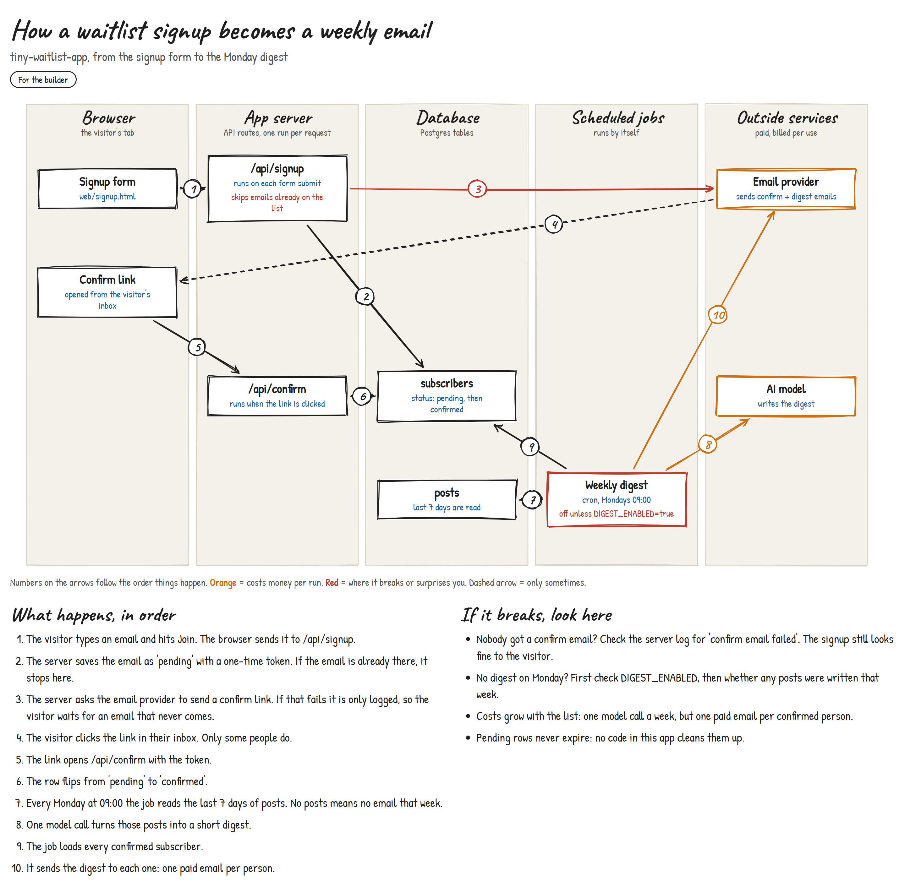

# draw-it: a Claude Code skill that draws how your system works



You inherit a system, or you build one with AI over a few weeks. It works. Then someone asks
how the pieces fit together, and nobody can explain it. Not you, not the last developer, and
not the AI that wrote it, because it starts every session cold.

`draw-it` makes Claude read the code and draw one picture of one flow: the pieces, where each
one runs, the order things happen, what costs money per run and where it breaks quietly. You
read it in a minute.

## What it does

1. **Asks two things first.** Which flow (one flow, not the whole repo) and who the picture is
   for: you, to understand and debug it, or your team, to brief people who don't read code.
   The team version drops every file, table and route name.
2. **Reads the code and traces the real path.** What starts it (a click, a cron, a webhook),
   what each step calls, what it writes, what fires next. Every box and arrow has to trace to
   code it read in that session. Anything it couldn't verify is left out and named.
3. **Writes a small JSON spec and renders it** into a single HTML page with a hand-drawn look:
   lanes for where things run, numbered arrows, the steps written out in plain sentences, and a
   short "if it breaks, look here" list. Orange marks what bills per run, red marks silent
   failures and gotchas, dashed arrows mark "only sometimes".
4. **Looks at its own output and fixes it** (overlapping badges, crossing arrows), if it has a
   browser tool to screenshot with.

No image model is involved. The drawing is plain SVG from the spec, so it is free, exact and
repeatable.

The image above is the real output for [`examples/tiny-waitlist-app`](examples/tiny-waitlist-app),
a small made-up app. Its spec is [`examples/waitlist-digest.json`](examples/waitlist-digest.json)
and the rendered page is [`examples/waitlist-digest.html`](examples/waitlist-digest.html).

## Requirements

- [Claude Code](https://docs.claude.com/en/docs/claude-code)
- Python 3.8 or newer. Standard library only, nothing to `pip install`.
- A web browser to open the result. The page loads two Google Fonts and
  [rough.js](https://roughjs.com) from a CDN for the hand-drawn look. Offline, it falls back to
  clean straight-line SVG.

## Install

macOS / Linux:

```bash
git clone https://github.com/milansolutionsai-ops/claude-code-draw-it.git
mkdir -p ~/.claude/skills
cp -r claude-code-draw-it/skills/draw-it ~/.claude/skills/
```

Windows (PowerShell):

```powershell
git clone https://github.com/milansolutionsai-ops/claude-code-draw-it.git
New-Item -ItemType Directory -Force "$HOME\.claude\skills"
Copy-Item -Recurse claude-code-draw-it\skills\draw-it "$HOME\.claude\skills\"
```

To use it in one project only, copy it into that project's `.claude/skills/` instead.

## Usage

In a Claude Code session inside the project, ask for it:

- "draw how the signup flow works"
- "I don't get what we built here, draw it"
- "make a diagram of the billing webhook for the team"

Or call it directly with `/draw-it`. The skill only runs when you ask; it never fires on its
own after a build.

The result lands in `diagrams/<flow>-<me|team>.html` in your working folder. Open it in a
browser. To share it, take a screenshot.

You can also render a spec yourself:

```bash
python ~/.claude/skills/draw-it/render.py spec.json out.html
```

`render.py` checks the spec first (unknown lanes, arrows pointing at boxes that don't exist,
two boxes in the same slot) and stops with a clear error instead of drawing a broken picture.
The spec format is documented in [`skills/draw-it/SKILL.md`](skills/draw-it/SKILL.md).

## What's in the repo

```
skills/draw-it/
  SKILL.md          the method: scope, audience, tracing rules, spec format, render-and-check loop
  render.py         validates a spec and fills the template
  template.html     the hand-drawn renderer (SVG + rough.js)
examples/
  tiny-waitlist-app/      a small made-up app, the input
  waitlist-digest.json    the spec Claude wrote for it
  waitlist-digest.html    the rendered page
  waitlist-digest.png     the screenshot at the top of this README
```

## License

MIT. Use it, change it, ship it.

Built by [Milan Veljkovikj](https://github.com/milansolutionsai-ops).
